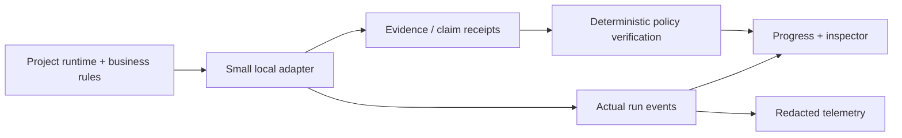

# Cross-project adoption playbook

**Status:** proposal. AEP is the reference control plane for evidence/provenance and run inspection; applications continue using their own runtime and data stores.

## First principle

**Reuse invariants before code.** Avoid moving unrelated private project data or replacing stable workflows simply to share a framework. Test the pattern with a tiny, reversible integration, then decide whether a shared npm package or language-neutral schema is justified.

## Adoption ladder

| Level | What changes | Definition of success |
| --- | --- | --- |
| **0: Describe** | One document maps authoritative inputs, computed outputs, actions, user roles and failure behavior | Diagram identifies every probabilistic and deterministic step |
| **1: Verify** | Add evidence IDs/revision identifiers, formula receipts, and explicit abstentions | Missing/altered evidence cannot produce a verified claim |
| **2: Observe** | Emit actual execution events and trace IDs from operations | Reviewer can reconstruct status and locate failures without debugger |
| **3: Govern** | Authenticated identity, scoped approval, idempotent side effects and review ledger | Wrong actor/tenant denied, retries safe |
| **4: Evaluate** | Synthetic golden tests + adversarial/isolation tests + CI hard gates | Regression detected automatically; skipped coverage clearly visible |

Move one level at a time; Level 3 is mandatory **before external actions or customer data**.

## Suggested pilot order

### 1. Deloitte — Meridian Sales Copilot (demonstration, Python/Streamlit)

**Goal:** add provenance to deterministic business calculations, not port the Streamlit app to Next.js.

- Keep pandas and source datasets as domain truth.
- Wrap each computed figure with input row IDs, revision or dataset digest, formula identifier, unit and output.
- Distinguish `verified_deterministic` calculations from language-only interpretations and unsupported causal explanations.
- Show real steps in Streamlit status/expanders; do not animate imaginary tool calls.
- Test fabricated $10M, unsupported intent, no-source, contradictory data, and exact recomputation.
- Do not import private assessment code or vendor materials into this public AEP repository.

**Proof:** three reviewer demonstrations (supported calculation, missing evidence, malicious fabricated number). A Python-produced JSON receipt can be validated against the proposed portable schema without a network call.

### 2. DCC Miami — consent-first operator and fabrication workflow (small controlled pilot)

**Goal:** demonstrate that requests and introductions respect trust boundaries before expanding automation.

- Airtable/CRM retains business truth; technical idempotency/session state stays in its own backend.
- Require explicit identity, consent and mutual approval before any contact revelation or outbound message.
- Source fabrication answers from current machine/material specifications and scoped job records, not model guesses.
- Make intake → scope → quote → payment → queue → fabrication → review → delivery → documentation observable as **business milestones**, not invented model reasoning.
- For one synthetic job, emit receipt IDs for quoted terms, operator acceptance, revisions and delivery.
- Do not publish customer contact, job files, or proprietary instructions to AEP.

**Proof:** unauthorized introduction is denied; duplicate messages/jobs do not duplicate actions; human-approved synthetic job has traceable receipts end to end.

### 3. BFI archival migration — revision and data lineage

**Goal:** make migration claims verifiable without exposing restricted archives.

- Model source revisions, stable record IDs, transformations, checksums and reconciliation counts.
- Preserve the source/normalized record lineage; distinguish staged/canary from approved production writes.
- Do not interpret migration statistics or completion state from AI-generated prose.
- Keep restricted Cargo, Webflow, Airtable and Drive content in their authorized systems.

**Proof:** replayable canary export, checksum reconciliation, explicitly recorded missing entries, and signed-off write gate.

### 4. AI24 automation / consulting workflows

**Goal:** standardize receipts across integrations without building a single central service.

- Business-rule transformations such as address title casing and phone formatting remain deterministic functions.
- Each scheduled or webhook execution records source input revision, normalized output, attempt/retry, result, and exception.
- External system writes require least-privilege identity, idempotency and explicit business authorization.
- Add visibility into success/failure and run duration, not imaginary AI reasoning.

**Proof:** duplicate input does not create duplicate mutations; malformed input is surfaced; dry-run output agrees with the actual write payload.

## Portability boundary

No runtime should be able to bypass its own business auth because a shared AEP adapter says `approved`. Only the owning application makes final authorization decisions.

## Measurement for the first pilot

Record these before generalizing:

| Measure | Expected pilot signal |
| --- | --- |
| **Provenance coverage** | All displayed material numeric claims have executable receipts |
| **Fail-closed behavior** | Every known missing/unsupported evidence fixture blocks verification |
| **Auth isolation** | Zero unauthorized cross-tenant reads and decisions in the fixture suite |
| **Replay reliability** | Duplicate/replayed event inputs do not multiply side effects |
| **Trace accuracy** | Every visible completed step corresponds to persisted real execution |
| **Review overhead** | Number of new lines, dependencies, database migrations, and integration friction is recorded |
| **Operator clarity** | A reviewer can point to the source, formula, failure and approval boundary in a short walkthrough |

Targets must be expressed as testable acceptance conditions; do not invent live reliability percentages or savings.

## Ready-to-ship checklist

- [ ] Product actor, data owner, and tenant boundary are written down.
- [ ] No public/production customer data flows into reference fixtures.
- [ ] Evidence and computation receipts are independently inspectable.
- [ ] Model uncertainty, source uncertainty and policy block are distinct statuses.
- [ ] Side-effecting tools require server authorization and exact-action approval.
- [ ] Run event metadata is measured, redacted and replayable.
- [ ] Unsupported citations, prompt injection and duplicate triggers have negative tests.
- [ ] Required integration tests demonstrably ran; test skips are displayed.
- [ ] Screenshots/demo statements are linked to real behavior.
- [ ] Version and rollback procedure are documented for adapters and data migrations.

## Stop conditions

Do **not** adopt AEP as a deployment dependency if doing so adds a second unauthorized data store, creates a second model/agent runtime, weakens existing access controls, or increases developer complexity without verified value. Prefer copying a small protocol or test fixture instead of importing the whole monorepo.
